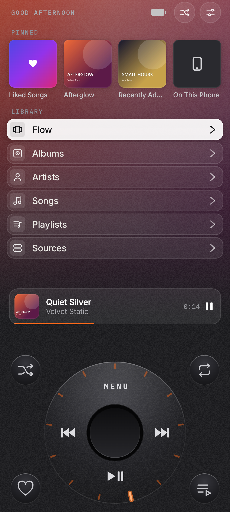
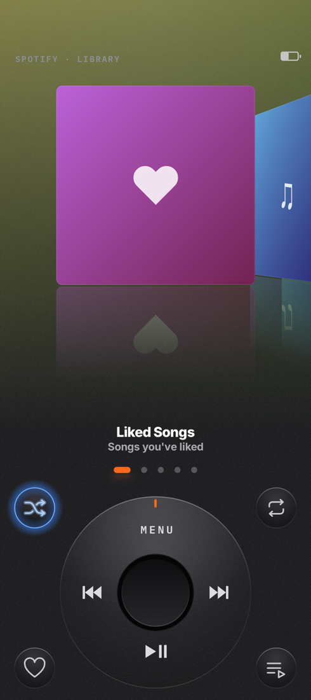
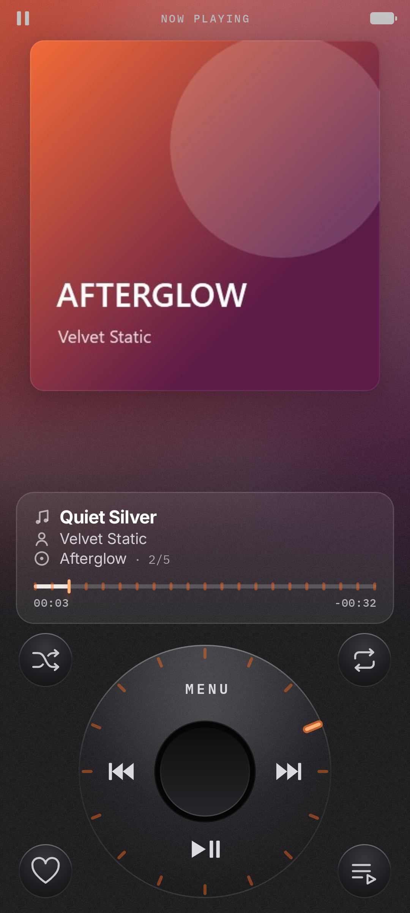
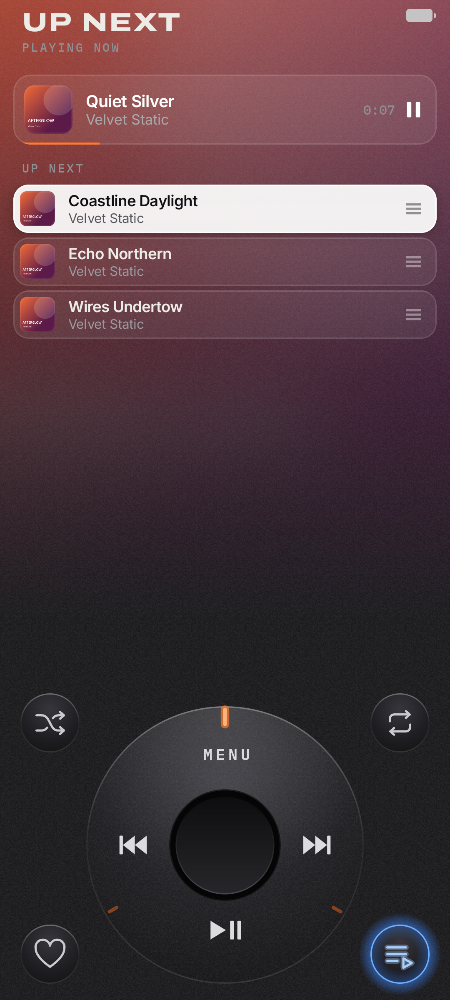

# Knurl

_Formerly called Detent._

**The phone is the iPod.** Knurl is an Android music player that turns your whole screen into one continuous graphite
plane with a Cover Flow style album carousel and a click wheel at the bottom. There is no fake device frame: the
phone itself is the player. It plays music from the phone and drives the Spotify app as a remote control, with the
library, queue, likes and now-playing info all shown in Knurl's own screens.

It is a personal project built for one person's Pixel 10a. It runs on any Android 10+ phone.

<p>
  
  
  
  
</p>

## Features

- **Flow** – a tilted, reflected album carousel (a reworked Cover Flow) for the music on the phone and for Spotify.
- **Click wheel** – drag around the ring to scroll, tap the quadrants for Menu / Previous / Next / Play-Pause, tap the
  centre to select. Every detent gives a haptic tick.
- **iPod-style menus** – Flow, Albums, Artists, Songs, Playlists, Sources, Shuffle Songs, Settings and Now Playing on
  frosted-glass rows with a bright white highlight. The look is called Graphite Glass: graphite with a faint grain, and a
  soft blurred wash of the playing cover at the top.
- **Home screen** – a greeting, round Shuffle and Settings buttons, a Pinned shelf (Liked Songs, last played album, Recently Added, On This Phone) and the library list. Albums are a grid, Artists have an A–Z rail, Playlists and Sources have their own lists, and Settings has a theme picker plus click sound, haptic ticks and wheel speed.
- **Widgets** – four home-screen widgets: small Now Playing (a knob whose orange arc is the song's progress), small Pinned, medium Now Playing with transport buttons, and large with the next three songs. They redraw when the song changes and every 30 seconds while playing.
- **Now Playing** – large cover art over a glass card with song / artist / album, a progress bar with scrubbing, and a volume bar. Select
  switches the wheel between volume and scrubbing.
- **Four corner buttons around the wheel** – shuffle (top-left), repeat (top-right), like (bottom-left) and Up Next
  (bottom-right). They glow blue when on; repeat-one shows a "1" badge.
- **Spotify, as a remote control** – browse Liked Songs, playlists, saved albums, followed artists and recently
  played albums as covers, then play them. The official Spotify app does the playing in the background; Knurl
  controls it and mirrors the track, cover art, position, shuffle and repeat. Requires Spotify Premium.
- **Like and Up Next** – like or unlike the song that is playing (Spotify Liked Songs; a favourites list inside
  Knurl for music on the phone) and see what plays next.
- **Mini player** – a card on the menu screens shows what is playing; tap it to open Now Playing.
- **Reopen where you left off** – close Knurl while Spotify keeps playing and it reconnects when you come back.
- Fullscreen with the Inter typeface; the camera cut-out is respected.

## Controls

| Gesture | Action |
| --- | --- |
| Drag around the ring | Scroll rows / step through covers / change volume / scrub (on Now Playing) |
| Tap **MENU** (top of ring) | Back (leaves scrub mode first) |
| Tap ⏮ / ⏭ | Previous / next song (in a Flow carousel: previous / next cover) |
| Tap ⏯ (bottom of ring) | Play / pause |
| Tap the centre | Select (on Now Playing: switch between volume and scrub) |
| Shuffle / Repeat button | Toggle shuffle; cycle repeat off → all → one |
| Heart button | Like / unlike the current song |
| Up Next button | Open or close the queue |
| Tap the mini player | Open Now Playing |

## Requirements

- Android 10 (API 29) or newer.
- For Spotify: Spotify Premium, the Spotify app installed and signed in on the same phone, and a Spotify developer
  app of your own (see [docs/spotify-setup.md](docs/spotify-setup.md)). Spotify development-mode apps are limited to a
  handful of users, which is fine for personal use.
- To build: JDK 17 and the Android SDK (platform 35).

## Build and run

```sh
# 1. Tell Gradle where the Android SDK is, and (optionally) your Spotify Client ID. Git ignores this file.
cat > local.properties <<'EOF'
sdk.dir=/path/to/Android/sdk
spotify.clientId=<your Spotify app's Client ID>
EOF

# 2. Build and install on a connected phone
export JAVA_HOME=/path/to/jdk-17
./gradlew :app:installDebug
```

Without a Client ID the app still works as a local player; the Spotify source just shows "Spotify isn't set up".
Music on the phone needs the audio permission, which the app asks for on first launch. Until then (or if the phone
has no music) it shows a small demo library.

The Spotify App Remote library lives in `app/libs/` (version 0.8.0, from
[github.com/spotify/android-sdk](https://github.com/spotify/android-sdk)). It is subject to Spotify's developer terms;
**remove it from the repository before ever making the repository public** and download it again locally.

## Project layout

```
app/src/main/java/app/knurl/
  MainActivity.kt          fullscreen window, permissions, Spotify sign-in redirect, session restore on resume
  KnurlApplication.kt     owns the single KnurlController so state survives activity recreation
  data/Library.kt          Album / Track models, MediaStore loading, album art loading, demo library
  playback/                Media3 player service and the controller wrapper the UI talks to
  spotify/                 PKCE sign-in, Web API client, App Remote wrapper
  ui/                      KnurlController (navigation + state), screens, click wheel, buttons, theme bits
docs/                      architecture and Spotify setup guides, screenshots
licenses/                  third-party licences that ship with the app (Inter)
```

See [docs/architecture.md](docs/architecture.md) for how the pieces fit together.

## Status

Working: local playback, all menus, Flow, Now Playing, mini player, shuffle / repeat / like / Up Next, Spotify
browsing and control, queue, reopen restore.

Not built yet:

- Subsonic / Navidrome / Jellyfin source (listed in Sources as "later").
- Other free sources: Audius, Jamendo, internet radio.
- Apple Music and YouTube Music (shown dimmed in Sources).
- Spotify search (the wheel can't type; would need an on-screen keyboard).
- A screen to browse the favourites liked from phone music.
- A release signing configuration (the Spotify dashboard needs the fingerprint of whatever key signs the build).

## Credits and licences

- [Inter](https://rsms.me/inter/) typeface, SIL Open Font License 1.1 (`licenses/Inter-OFL.txt`).
- Spotify App Remote SDK and Web API, used under [Spotify's developer terms](https://developer.spotify.com/terms).
  Knurl does not stream or decode Spotify audio; the Spotify app does.
- AndroidX Media3 and Jetpack Compose (Apache 2.0), Gson (Apache 2.0).

The project itself is a private personal project with no open-source licence: all rights reserved.
